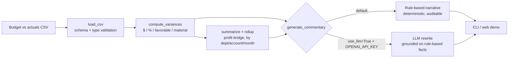

# AI Variance Analyst

[](https://github.com/hrutishaa/ai-variance-analyst/actions/workflows/ci.yml)
[](LICENSE)

**🔴 Live demo: https://hrutishaa.github.io/ai-variance-analyst/** (no sign-up, no API key; runs entirely in your browser)

An AI-assisted **budget vs actuals variance analyst** for FP&A and business analysts. Drop in a CSV of budget and actuals by department, account and month. You get:

- **$ and % variances** for every line, with the sign handled correctly (revenue over plan is *favorable*, expense over plan is *unfavorable*)
- **Materiality flags** using a configurable *% AND $* threshold, the usual FP&A rule, so small accounts don't flood the report
- **Charts:** net profit impact by department, and monthly operating profit budget vs actual
- A **sortable, filterable variance table**
- **Plain-English commentary**, ready for a CFO: headline profit bridge, top material variances, likely drivers, and follow-ups

> Month-end close usually ends with an analyst writing "Cloud hosting was $15K over budget due to…" forty times. This tool does the first draft in seconds, and every sentence can be traced back to a number.

## Architecture



The math lives in a tiny, dependency-free Python package (`variance_analyst/`) with pytest coverage. The live demo (`docs/`) is a static page that mirrors the same logic in JavaScript. CI checks that both use the same sample data.

**Why rule-based first?** Finance commentary has to be correct and auditable. The deterministic layer produces the facts. The optional LLM layer only rewrites them, its prompt says to use only numbers that appear in the facts, and if there's no key or the call fails it falls back to the deterministic text.

## Quickstart

```bash
git clone https://github.com/hrutishaa/ai-variance-analyst && cd ai-variance-analyst
python -m venv .venv && source .venv/bin/activate   # Windows: .venv\Scripts\activate
pip install -e ".[dev]"
pytest                                               # 20 tests
python -m variance_analyst data/sample_budget_vs_actuals.csv --pct 0.10 --abs 5000
```

Optional LLM polish (any OpenAI-compatible endpoint):

```bash
export OPENAI_API_KEY=...            # never commit keys
python -m variance_analyst data/sample_budget_vs_actuals.csv --llm
```

Run the web demo locally: `python -m http.server -d docs 8000`, then open http://localhost:8000.

### Use as a library

```python
from variance_analyst import load_csv, compute_variances, generate_commentary
lines = compute_variances(load_csv("my_bva.csv"), pct_threshold=0.08, abs_threshold=10_000)
print(generate_commentary(lines))
```

## CSV format

| column | example | notes |
|---|---|---|
| month | 2026-03 | any sortable label |
| department | Engineering | |
| account | Cloud Hosting | keywords drive the "likely driver" hints |
| account_type | expense | `revenue` or `expense` |
| budget | 48000 | thousands separators allowed |
| actual | 63360 | |

The sample data (`data/sample_budget_vs_actuals.csv`) is synthetic: a SaaS company in H1 2026, 4 departments and 90 lines, with realistic shocks built in such as a cloud cost spike, a subscription revenue miss and a hiring slip.

## Project layout

```
variance_analyst/   core.py (math), commentary.py (narrative + optional LLM), cli.py
tests/              pytest suite (variance math, materiality, validation, commentary, CLI)
data/               synthetic sample dataset
docs/               static live demo (GitHub Pages)
```

See [ROADMAP.md](ROADMAP.md) for what's next.

## License

MIT © 2026 Hrutishaa Nanduti
