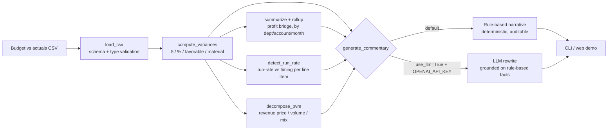

# AI Variance Analyst

[](https://github.com/hrutishaa/ai-variance-analyst/actions/workflows/ci.yml)
[](LICENSE)

**🔴 Live demo: https://hrutishaa.github.io/ai-variance-analyst/** (no sign-up, no API key; runs entirely in your browser)

An AI-assisted **budget vs actuals variance analyst** for FP&A and business analysts. Drop in a CSV of budget and actuals by department, account and month. You get:

- **$ and % variances** for every line, with the sign handled correctly (revenue over plan is *favorable*, expense over plan is *unfavorable*)
- **Materiality flags** using a configurable *% AND $* threshold, the usual FP&A rule, so small accounts don't flood the report
- **Run-rate vs timing detection:** a variance that stays material in the same direction for N+ consecutive months (default 2) is flagged as *run-rate* (re-forecast it); one that reverses or doesn't repeat is *timing*
- **Price / volume / mix** for revenue: add optional unit columns and each revenue variance is split into price, volume and mix effects that add up exactly to the variance
- **Charts:** net profit impact by department, and monthly operating profit budget vs actual
- A **sortable, filterable variance table**
- **Plain-English commentary**, ready for a CFO: headline profit bridge, top material variances, likely drivers, and follow-ups

> Month-end close usually ends with an analyst writing "Cloud hosting was $15K over budget due to…" forty times. This tool does the first draft in seconds, and every sentence can be traced back to a number.

## Architecture



The math lives in a tiny, dependency-free Python package (`variance_analyst/`) with pytest coverage. The live demo (`docs/`) is a static page that mirrors the same logic in JavaScript. CI checks that both use the same sample data, and a parity test runs the price / volume / mix JavaScript under Node and compares it with Python.

**Why rule-based first?** Finance commentary has to be correct and auditable. The deterministic layer produces the facts. The optional LLM layer only rewrites them, its prompt says to use only numbers that appear in the facts, and if there's no key or the call fails it falls back to the deterministic text.

## Quickstart

```bash
git clone https://github.com/hrutishaa/ai-variance-analyst && cd ai-variance-analyst
python -m venv .venv && source .venv/bin/activate   # Windows: .venv\Scripts\activate
pip install -e ".[dev]"
pytest                                               # 62 tests
python -m variance_analyst data/sample_budget_vs_actuals.csv --pct 0.10 --abs 5000 --run-rate-months 2
python -m variance_analyst data/sample_revenue_pvm.csv   # adds the price / volume / mix section
```

Optional LLM polish (any OpenAI-compatible endpoint):

```bash
export OPENAI_API_KEY=...            # never commit keys
python -m variance_analyst data/sample_budget_vs_actuals.csv --llm
```

Run the web demo locally: `python -m http.server -d docs 8000`, then open http://localhost:8000.

### Use as a library

```python
from variance_analyst import load_csv, compute_variances, generate_commentary
lines = compute_variances(load_csv("my_bva.csv"), pct_threshold=0.08, abs_threshold=10_000)
print(generate_commentary(lines))

from variance_analyst import detect_run_rate
for p in detect_run_rate(lines, min_months=2):
    if p.pattern == "run-rate":
        print(p.department, p.account, p.streak, "months", p.streak_variance)

from variance_analyst import decompose_pvm   # needs budget_units / actual_units columns
for g in decompose_pvm(lines):               # by_month=True for one bridge per month
    print(g.department, g.price_effect, g.volume_effect, g.mix_effect)
```

## Run-rate vs timing

Month-end reviews spend most of their time on one question: *will this variance come back next month?* `detect_run_rate` answers it per line item (department + account), as of the latest month in the file:

| pattern | rule | what to do |
|---|---|---|
| `run-rate` | material **and** same direction for N+ consecutive months ending at the latest month (`--run-rate-months`, default 2) | treat it as the new baseline and re-forecast |
| `timing` | material at least once, but it reversed, didn't repeat, or is new this month | confirm phasing with the budget owner; expect it to unwind |
| `none` | never material | nothing |

A non-material month, a sign flip, or a month missing for that line breaks the streak. On the sample data it flags the Engineering cloud spike (unfavorable 4 months running, $52.7K cumulative) and the Subscription Revenue miss (2 months running) as run-rate, and the one-off contractor and paid-marketing spikes as timing. Commentary output:

```
Run-rate vs timing (material in the same direction for 2+ consecutive months through 2026-06):
- Sales Subscription Revenue: unfavorable for 2 months running (2026-05 to 2026-06, $237.9K cumulative); likely run-rate, consider re-forecast.
- Engineering Cloud Hosting: unfavorable for 4 months running (2026-03 to 2026-06, $52.7K cumulative); likely run-rate, consider re-forecast.
- Timing (did not repeat): Engineering Salaries (2026-04), Marketing Paid Marketing (2026-04), Engineering Contractors (2026-02). Likely phasing; confirm with budget owners.
- New in 2026-06: Sales Professional Services Revenue, Marketing Events. Watch next month; a repeat makes it run-rate.
```

The web demo shows the same result as a *Run-rate items* KPI, a sortable *Pattern* column (`run-rate ×N` / `timing`) and an adjustable *Run-rate months* control.

## Price / volume / mix

Revenue that lands on plan can still hide problems: more units sold at a lower price, or growth that came from the cheapest product. Add `budget_units` and `actual_units` to revenue rows (seats, licenses, hours; leave them blank on expense rows) and `decompose_pvm` splits each revenue variance into three effects. Every line item is a product and products in the same department form a group, so keep comparable products (counted in the same unit) in one department.

| effect | formula (per product *i*; B = budget, A = actual, Q = units, P = $ / units) | answers |
|---|---|---|
| price | (AP<sub>i</sub> − BP<sub>i</sub>) × AQ<sub>i</sub> | did we sell cheaper or dearer than plan? |
| volume | (AQ<sub>total</sub> − BQ<sub>total</sub>) × BMix<sub>i</sub> × BP<sub>i</sub> | did we sell more or fewer units in total? |
| mix | (AQ<sub>i</sub> − AQ<sub>total</sub> × BMix<sub>i</sub>) × BP<sub>i</sub> | did the blend shift toward cheaper or pricier products? |

Price + volume + mix equals actual − budget exactly, per product and per group (the tests check this). New products (no budget units) show up as mix, not price. A product with no actual units has no price effect. A line with dollars but zero units is rejected because its price is undefined.

On the product-level sample (`data/sample_revenue_pvm.csv`), subscription revenue is only +$13.6K vs plan, but the bridge shows why: volume +$125.5K, price −$40.1K (Pro plan discount from April) and mix −$71.8K (growth came mostly from the Starter plan). Commentary output:

```
Price / volume / mix (revenue lines with units, 2026-01 to 2026-06):
- Services: revenue $468.0K vs budget $486.0K (-$18.0K). Price +$36.0K, volume -$54.0K, mix $0. Largest effect: volume (2,400 units sold vs 2,700 budget).
- Subscriptions: revenue $1.98M vs budget $1.97M (+$13.6K). Price -$40.1K, volume +$125.5K, mix -$71.8K. Largest effect: volume (25,132 units sold vs 23,625 budget).
```

In the web demo, click **Load price/volume/mix sample** (or upload a CSV with unit columns) to get a budget → price → volume → mix → actual bridge chart and a product table with units and average prices.

## CSV format

| column | example | notes |
|---|---|---|
| month | 2026-03 | any sortable label (`YYYY-MM` recommended so run-rate streaks order correctly) |
| department | Engineering | |
| account | Cloud Hosting | keywords drive the "likely driver" hints |
| account_type | expense | `revenue` or `expense` |
| budget | 48000 | thousands separators allowed |
| actual | 63360 | |
| budget_units | 1200 | optional, with `actual_units`: units for price / volume / mix (revenue rows; blank elsewhere) |
| actual_units | 1190 | optional |

The sample data (`data/sample_budget_vs_actuals.csv`) is synthetic: a SaaS company in H1 2026, 4 departments and 90 lines, with realistic shocks built in: a cloud cost spike that persists (run-rate), a two-month subscription revenue miss, one-off contractor and campaign spikes (timing), and a hiring slip.

`data/sample_revenue_pvm.csv` is a second synthetic file: 3 subscription plans (seats), an implementation service (hours) and 2 expense lines over H1 2026, with a Pro plan discount, Starter-heavy growth and fewer service hours at a higher rate built in.

## Project layout

```
variance_analyst/   core.py (math), runrate.py (run-rate vs timing), pvm.py (price / volume / mix), commentary.py (narrative + optional LLM), cli.py
tests/              pytest suite (variance math, materiality, validation, run-rate streaks, price/volume/mix, JS parity, commentary, CLI)
data/               synthetic sample datasets
docs/               static live demo (GitHub Pages); pvm.js holds the price / volume / mix logic
```

See [ROADMAP.md](ROADMAP.md) for what's next.

## License

MIT © 2026 Hrutishaa Nanduti
